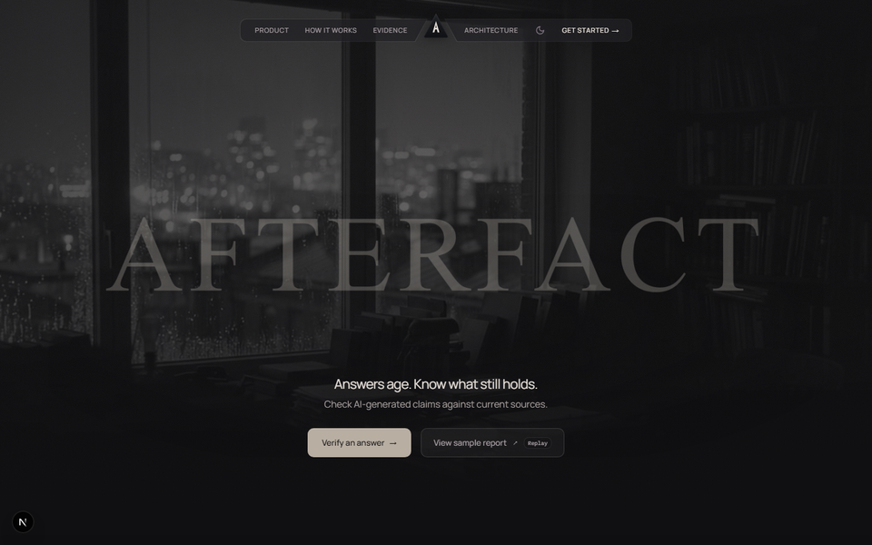
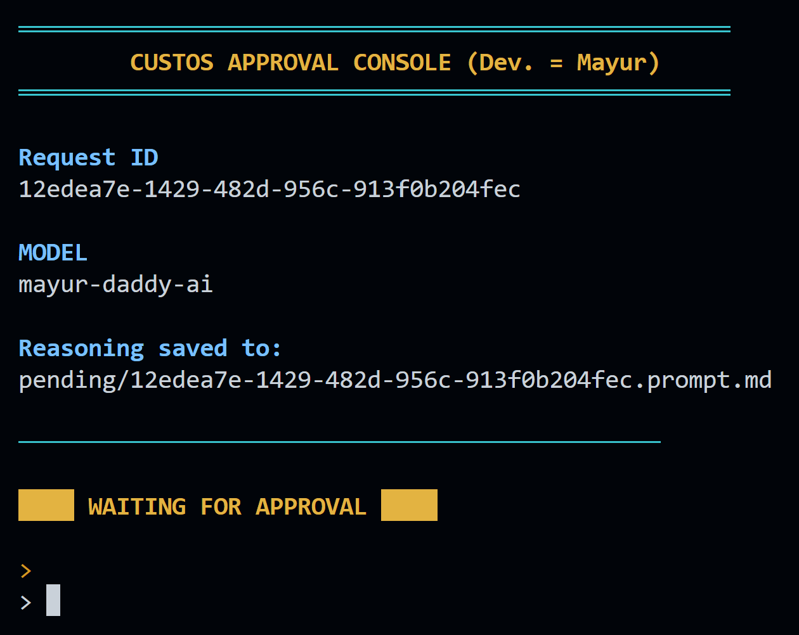

# M A Y U R &nbsp; N A N D A

*systems · software · intelligence*

<table>
<tr>
<td width="55%" valign="middle">

<i>"i like understanding how things work, then making them work differently."</i>

currently exploring distributed systems, AI, and developer tools.

forge · afterfact · custos · focusflow · funcundo · indago · rammy

Delhi, India · building quietly.

</td>
<td width="45%" align="center" valign="middle">

</td>
</tr>
</table>

  

# S E L E C T E D &nbsp; P R O J E C T S

*distributed systems · intelligence · developer platforms*

 

<table>
<tr>
<td width="50%" valign="top" align="left">

  

<b><a href="https://github.com/Mayur11code/Forge">Forge</a></b> &nbsp;·&nbsp; <a href="https://forge-pi-jet.vercel.app/"><i>Live Demo ↗</i></a>
 
Multi-tenant DAG workflow orchestration engine built for concurrency, isolated by design, and driven by immutable events.
  
<code>Next.js 16</code> · <code>React Flow</code> · <code>Pusher</code> · <code>PostgreSQL</code> · <code>Redis</code>

</td>
<td width="50%" valign="top" align="left">

  

<b><a href="https://github.com/Mayur11code/Afterfact">Afterfact</a></b> &nbsp;·&nbsp; <a href="https://afterfact-beta.vercel.app"><i>Live Demo ↗</i></a>
 
Real-time freshness verification and semantic drift detection engine for AI-generated answers across evolving knowledge bases.
  
<code>Next.js</code> · <code>AI Drift Detection</code> · <code>TypeScript</code> · <code>Tailwind CSS</code>

</td>
</tr>
<tr>
<td width="50%" valign="top" align="left">

  

<b><a href="https://github.com/Mayur11code/CUSTOS.dev">CUSTOS</a></b> &nbsp;·&nbsp; <a href="https://github.com/Mayur11code/CUSTOS.dev"><i>Repository ↗</i></a>
 
Human-in-the-loop OpenAI-compatible proxy inserting deterministic review and approval gates into autonomous AI coding workflows.
  
<code>Node.js 18+</code> · <code>TypeScript</code> · <code>OpenAI API</code> · <code>DevTools</code>

</td>
<td width="50%" valign="top" align="left">

  

<b><a href="https://github.com/Mankirat684/FuncUndo-side">FuncUndo</a></b> &nbsp;·&nbsp; <a href="https://github.com/Mankirat684/FuncUndo-side"><i>Repository ↗</i></a>
 
The semantic code time machine for VS Code. Understands ASTs to track function logic changes and assess call-stack reversion risks.
  
<code>VS Code API</code> · <code>TypeScript</code> · <code>SQLite WASM</code> · <code>Tree-sitter</code>

</td>
</tr>
<tr>
<td width="50%" valign="top" align="left">

  

<b><a href="https://github.com/NERIS-v/INDAGO">INDAGO</a></b> &nbsp;·&nbsp; <a href="https://github.com/NERIS-v/INDAGO"><i>Repository ↗</i></a>
 
Evidence-to-graph investigative intelligence platform converting fragmented records into defensible, reviewable leads.
  
<code>TypeScript</code> · <code>Graph Analytics</code> · <code>Temporal Versioning</code> · <code>Zod</code>

</td>
<td width="50%" valign="top" align="left">

  

<b><a href="https://github.com/Mayur11code/RAMMY">RAMMY</a></b> &nbsp;·&nbsp; <a href="https://github.com/Mayur11code/RAMMY"><i>Repository ↗</i></a>
 
Deterministic evidence-intelligence platform & Research OS: retrieval → evidence packs → knowledge graph → grounded lens analysis.
  
<code>TypeScript</code> · <code>PostgreSQL</code> · <code>pgvector</code> · <code>Drizzle ORM</code>

</td>
</tr>
<tr>
<td width="50%" valign="top" align="left">

  

<b><a href="https://github.com/Mayur11code/LEXI-ASSIST">LEXI-ASSIST</a></b> &nbsp;·&nbsp; <a href="https://lexi-assist.vercel.app/"><i>Live Demo ↗</i></a>
 
Intelligent legal advisor analyzing complex documents, automating structured workflows, and matching clients with lawyers.
  
<code>Next.js</code> · <code>AI / NLP</code> · <code>Legal Tech</code> · <code>TypeScript</code>

</td>
<td width="50%" valign="top" align="left">

  

<b><a href="https://github.com/Mayur11code/Yuva-Udyam">Yuva-Udyam</a></b> &nbsp;·&nbsp; <a href="https://yuva-udyam.vercel.app"><i>Live Demo ↗</i></a>
 
Interactive ecosystem platform empowering youth entrepreneurship with venture tools, incubation workflows, and collaboration.
  
<code>Next.js</code> · <code>React</code> · <code>Tailwind CSS</code> · <code>Full-Stack</code>

</td>
</tr>
<tr>
<td width="50%" valign="top" align="left">

  

<b><a href="https://github.com/Mayur11code/athleteInjuryRecoveryPrediction-projectMlSih">Athlete Injury Recovery</a></b> &nbsp;·&nbsp; <a href="https://github.com/Mayur11code/athleteInjuryRecoveryPrediction-projectMlSih"><i>Repository ↗</i></a>
 
Machine learning application predicting athlete injury recovery duration and tailored rehabilitation based on clinical injury profiles.
  
<code>Python</code> · <code>Scikit-Learn</code> · <code>Machine Learning</code> · <code>Data Science</code>

</td>
<td width="50%" valign="top" align="left">

  

<b><a href="https://github.com/Mayur11code/SoulBloom-">SoulBloom</a></b> &nbsp;·&nbsp; <a href="https://github.com/Mayur11code/SoulBloom-"><i>Repository ↗</i></a>
 
Interactive emotional wellness and mental health companion designed for reflective support, sentiment tracking, and mindfulness.
  
<code>React</code> · <code>Node.js</code> · <code>Express</code> · <code>Full-Stack</code>

</td>
</tr>
</table>

