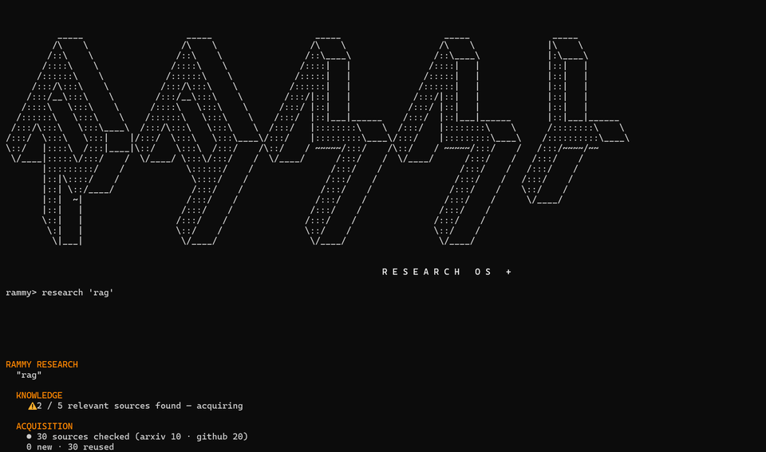

# M A Y U R &nbsp; N A N D A

*systems · software · intelligence*

<table>
<tr>
<td width="55%" valign="middle">

<i>"i like understanding how things work, then making them work differently."</i>

currently exploring distributed systems, AI, and developer tools.

rammy · forge · afterfact · indago · custos · funcundo · lexi-assist

Delhi, India · building quietly.

</td>
<td width="45%" align="center" valign="middle">

</td>
</tr>
</table>

 

### S E L E C T E D &nbsp; P R O J E C T S

*distributed systems · intelligence · developer platforms*

 

<table>
<tr>
<td width="50%" valign="top" align="left">

  

 
<b>RAMMY</b> &nbsp; 
 
Deterministic evidence-intelligence platform & Research OS: retrieval → evidence packs → knowledge graph → grounded lens analysis.
 
<code>TypeScript</code> · <code>PostgreSQL</code> · <code>pgvector</code> · <code>Drizzle ORM</code>

</td>
<td width="50%" valign="top" align="left">

  

 
<b>Forge</b> &nbsp;  &nbsp; 
 
Multi-tenant DAG workflow orchestration engine built for concurrency, isolated by design, and driven by immutable events.
 
<code>Next.js 16</code> · <code>React Flow</code> · <code>Pusher</code> · <code>PostgreSQL</code> · <code>Redis</code>

</td>
</tr>
<tr>
<td width="50%" valign="top" align="left">

  

 
<b>Afterfact</b> &nbsp;  &nbsp; 
 
Real-time freshness verification and semantic drift detection engine for AI-generated answers across evolving knowledge bases.
 
<code>Next.js</code> · <code>AI Drift Detection</code> · <code>TypeScript</code> · <code>Tailwind</code>

</td>
<td width="50%" valign="top" align="left">

  

 
<b>INDAGO</b> &nbsp; 
 
Evidence-to-graph investigative intelligence system turning fragmented records into defensible, reviewable leads.
 
<code>TypeScript</code> · <code>Graph Analytics</code> · <code>Temporal</code> · <code>Zod</code>

</td>
</tr>
<tr>
<td width="50%" valign="top" align="left">

  

 
<b>CUSTOS</b> &nbsp; 
 
Human-in-the-loop OpenAI-compatible proxy inserting deterministic review and approval gates into autonomous AI coding workflows.
 
<code>Node.js 18+</code> · <code>TypeScript</code> · <code>OpenAI API</code> · <code>DevTools</code>

</td>
<td width="50%" valign="top" align="left">

  

 
<b>FuncUndo</b> &nbsp; 
 
The semantic code time machine for VS Code. Understands ASTs to track function logic changes and assess call-stack reversion risks.
 
<code>VS Code API</code> · <code>TypeScript</code> · <code>SQLite WASM</code> · <code>Tree-sitter</code>

</td>
</tr>
<tr>
<td width="50%" valign="top" align="left">

  

 
<b>LEXI-ASSIST</b> &nbsp;  &nbsp; 
 
Intelligent legal advisor analyzing complex documents, automating structured workflows, and matching clients with lawyers.
 
<code>Next.js</code> · <code>AI / NLP</code> · <code>Legal Tech</code> · <code>TypeScript</code>

</td>
<td width="50%" valign="middle" align="center">

  
<i>more in development · building quietly</i>
  
<code>systems</code> · <code>software</code> · <code>intelligence</code>

</td>
</tr>
</table>

